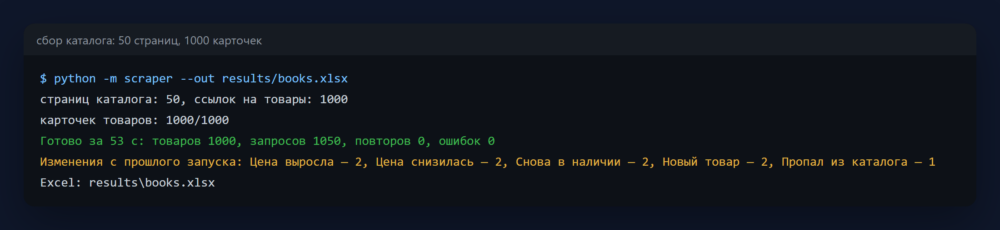
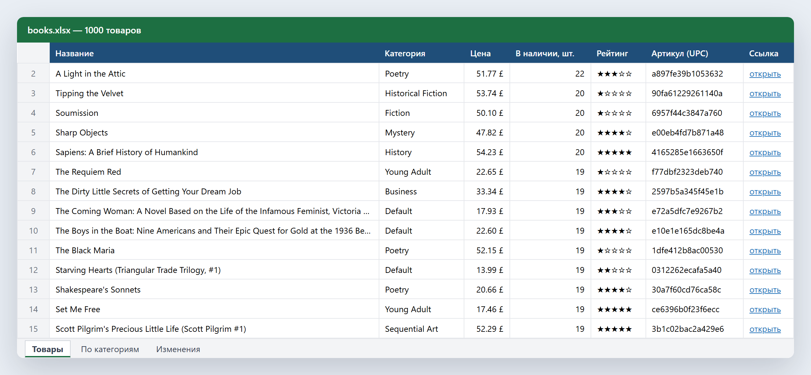
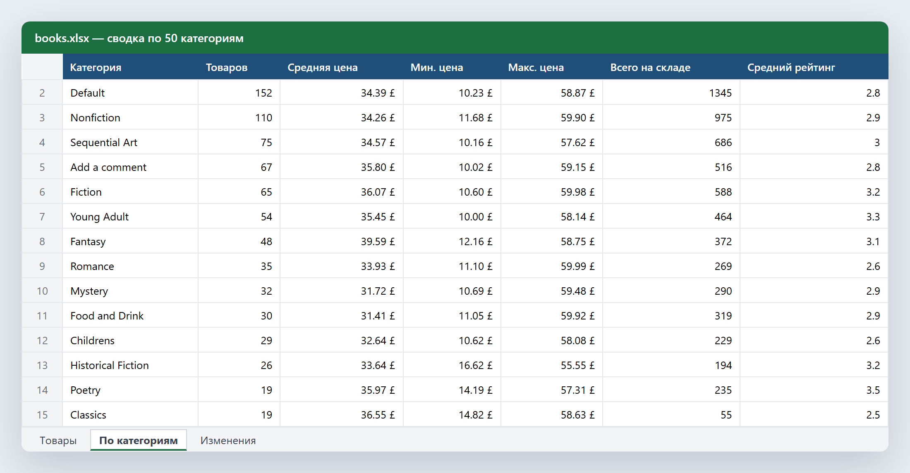
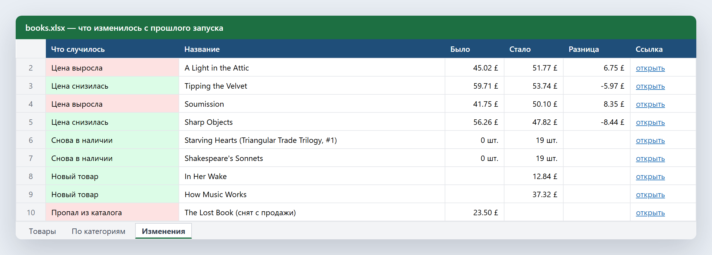
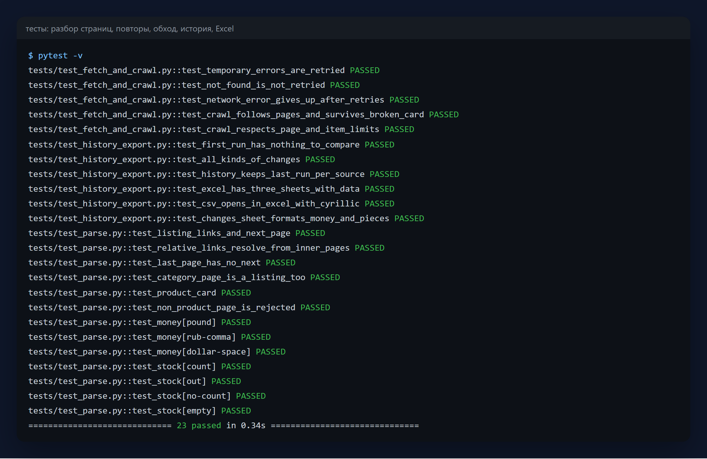

# Парсер каталога в Excel

Собирает весь каталог интернет-магазина — названия, категории, цены, остатки,
рейтинг, артикулы, описания — и выгружает в аккуратный Excel. При каждом
следующем запуске сравнивает с прошлым и показывает, что изменилось: цены,
наличие, новые и пропавшие товары. Типовая задача «мониторинг цен
конкурентов».

Python 3.11+ · asyncio · httpx · selectolax · openpyxl · SQLite · pytest



> Демо работает на [books.toscrape.com](https://books.toscrape.com/) — учебном
> магазине, сделанном специально для отработки парсинга (1000 книг, цены в
> фунтах). Под другой сайт меняется только модуль разбора страниц.

## Что внутри

- **Скорость без перегрузки сайта.** Страницы списка обходятся по порядку,
  карточки товаров — параллельно, но с ограничением одновременных запросов
  и паузой после каждого. Весь каталог — 1050 запросов — за 52 секунды.
- **Устойчивость.** Временные ошибки (429, 5xx, обрыв сети) повторяются с
  нарастающей паузой; 404 не повторяется. Упавшая карточка не останавливает
  обход — в конце видно, сколько было повторов и ошибок.
- **История и изменения.** Каждый запуск сохраняется в SQLite. Следующий
  сравнивается с прошлым по артикулу: цена выросла или снизилась, товар
  закончился или снова появился, новые и пропавшие позиции.
- **Excel, с которым удобно работать.** Три листа: «Товары» (фильтры,
  закреплённая шапка, формат денег, звёзды рейтинга, ссылки на товар,
  подсветка нулевого остатка), «По категориям» (сколько товаров, средняя,
  минимальная и максимальная цена, остатки) и «Изменения». По желанию —
  CSV, который Excel открывает с кириллицей без настроек.

| Товары | По категориям | Изменения |
|---|---|---|
|  |  |  |

Лист «Изменения» на скриншоте — со второго запуска, перед которым в истории
вручную поменяли несколько прошлых цен и остатков, чтобы показать все виды
изменений: на учебном сайте цены сами не меняются.

## Запуск

```bash
pip install -r requirements.txt
python -m scraper                          # весь каталог → results/catalog_<дата>.xlsx
python -m scraper --pages 5 --csv          # первые 5 страниц, плюс CSV
python -m scraper --concurrency 4 --delay 0.5 --out prices.xlsx
```

По расписанию — через cron или Планировщик задач Windows, например раз в
день: каждый запуск сам сравнится с предыдущим.

## Тесты

```bash
pytest -v
```

Разбор страниц на сохранённых HTML, повторы при ошибках и отказ от повтора на
404, обход с «падающей» карточкой на подменённом сайте (без сети), все виды
изменений, история по нескольким источникам, листы Excel и форматы ячеек, CSV.



## Структура

```
scraper/fetch.py     загрузка: лимит параллельности, паузы, повторы
scraper/parse.py     разбор страниц списка и карточки товара
scraper/crawler.py   обход каталога
scraper/history.py   история запусков и поиск изменений
scraper/export.py    Excel и CSV
scraper/__main__.py  запуск из командной строки
tests/               тесты и сохранённые страницы
```

## Лицензия

MIT — см. [LICENSE](LICENSE).
